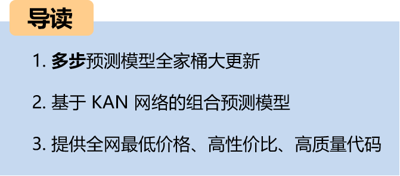
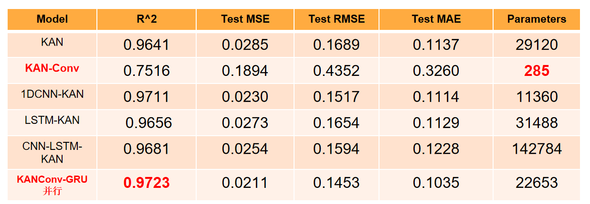
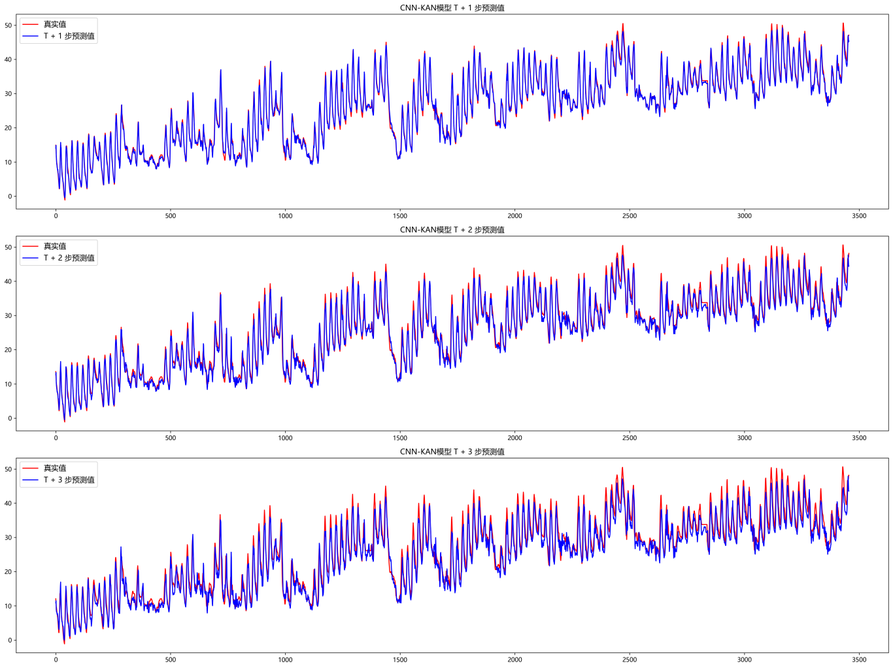
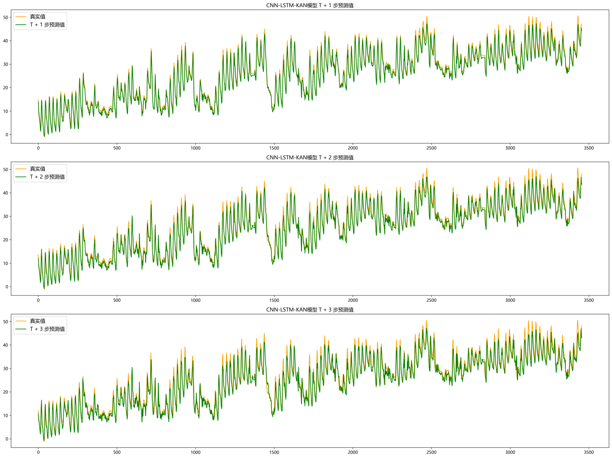
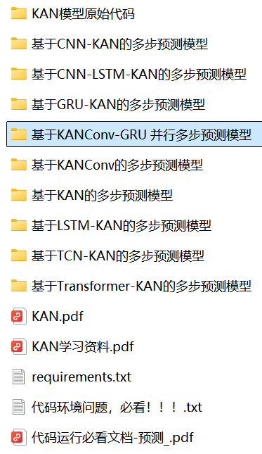
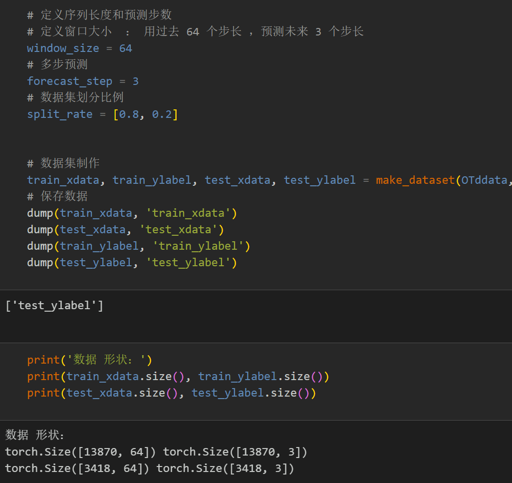
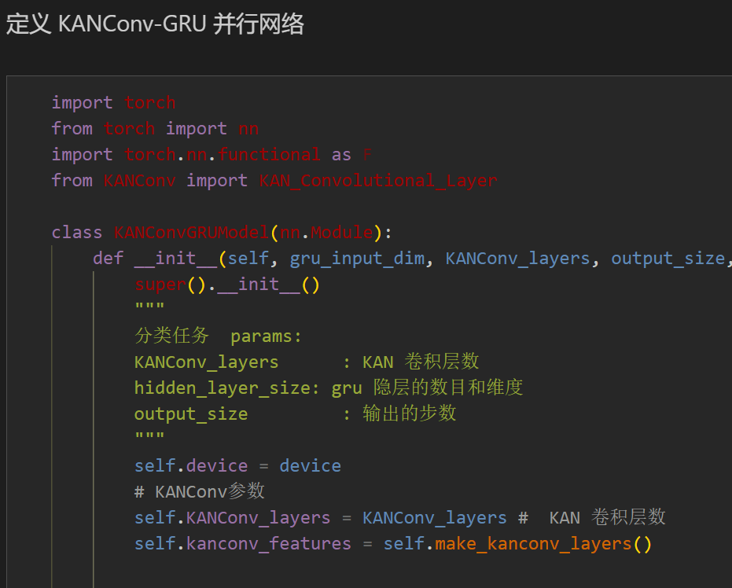
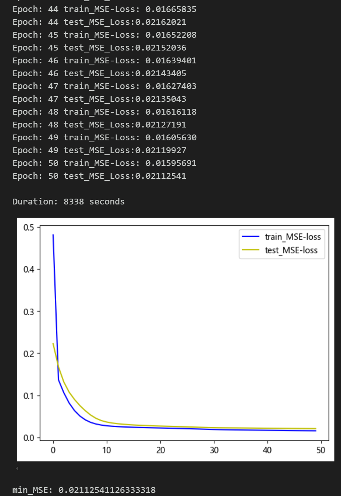
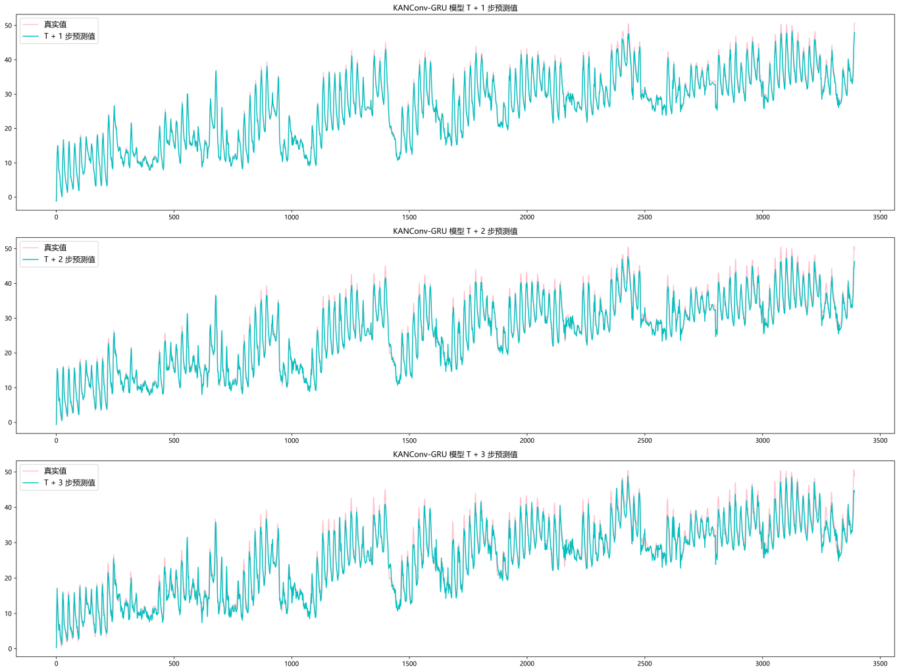
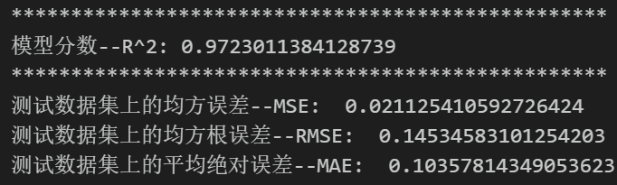

# Hotspot Innovation | Multi-Step Prediction Model Based on KANConv-GRU Parallel

Multi-step Prediction Family Kit Major Update!!!
This period, we continue to update the multi-step prediction family kit, incorporating KAN and CKAN (Convolutional Kolmogrov-Arnold Network) into the multi-step prediction model. We have added new models for parallel prediction such as KAN, KANConv, CNN-KAN, LSTM-KAN, TCN-KAN, Transformer-KAN, GRU-KAN, CNN-LSTM-KAN, KANConv-GRU, achieving high-precision predictions. This helps everyone grasp hotspots and publish articles early!
Environmental Framework: Python 3.9, PyTorch 1.8 or above are required to run.
Complimentary Files: Comprehensive environment setup and installation tutorials, detailed documentation on models and parameters.
Target Audience: Those requiring papers or graduation projects.
Code Guarantees: Code is commented in detail, ready to run without modification.
The complete process includes data preparation, data loading, model definition, parameter setting, model training, model testing, prediction visualization, and model evaluation.
KANN-based Multi-step Prediction Model
Researchers extend the innovative concept of KAN to convolutional neural networks, replacing the classic linear transformation of convolution with a learnable nonlinear activation function per pixel, proposing and open-sourcing KAN Convolution (CKAN).
Compared experiments show that KAN Convolution achieves certain prediction effects with very small parameter quantities, holding research value for future lightweight prediction network models!
When KAN networks replace the final linear layer, they demonstrate good performance.
Visualization of related innovative models
Update introduction:
Preface
This article is based on the preliminary introduction of the power transformer (data set attached at the end of this document), introducing a multi-step prediction model based on the KANConv-GRU parallel network. For a detailed introduction to the power transformer dataset, please refer to the following text:
Introduction to the Power Transformer Dataset and Preprocessing
1 Data Preprocessing and Visualization of Electric Power Transformers
1.1 Import data
1.2 Multi-step Preprocessing for Prediction
\t  
2. Multi-step Prediction Model Based on KANConv-GRU
2.1 Define the KANConv-GRU network model
\t  
2.2 Set parameters and train the model
50 epochs, MSE is 0.0211, the KANConv-GRU multi-step prediction model has a significant predictive effect. The model can fully extract the spatiotemporal features of sequences, converges quickly, and exhibits superior performance with high prediction accuracy, indicating good performance.
3 Results Visualization and Model Evaluation
3.1 Visualization of Prediction Results
3.2 Model Evaluation
Click to download: Complete original data, Python code
Previously Featured Content:
Time Series Forecasting: Analysis and comparison of LSTM, ARIMA, Holt-Winters, SARIMA models
Wind Speed Prediction (Part 1) Data Set Introduction and Preprocessing
Wind Speed Prediction (II) EMD-LSTM Model Based on Pytorch
Wind Speed Prediction (III) EMD-LSTM-Attention Model
Wind Speed Prediction (IV) EMD-Transformer Model Based on Pytorch
Wind Speed Prediction (5) EMD-CNN-LSTM Model Based on Pytorch
Wind Speed Prediction (VI) - EMD-CNN-GRU Parallel Model Based on Pytorch
CEEMDAN + Combination Forecasting Model (BiLSTM-Attention + ARIMA)
CEEMDAN + Combination Prediction Model (CNN-LSTM + ARIMA)
CEEMDAN + Combination Prediction Model (Transformer - BiLSTM + ARIMA)
CEEMDAN + Combination Prediction Model (CNN-Transformer + ARIMA)
Multi-Feature Variable Sequence Forecasting (I) - CNN-LSTM Wind Speed Forecasting Model
Multi-Feature Variable Sequence Forecasting (II) - CNN-LSTM-Attention Wind Speed Forecasting Model
Multi-Feature Variable Sequence Forecasting (III) - CNN-Transformer Wind Speed Forecasting Model
Multi-Feature Variable Sequence Forecasting (IV) Transformer-BiLSTM Wind Speed Forecasting Model
Multi-Feature Variable Sequence Forecasting (V) CEEMDAN+CNN-LSTM Wind Speed Forecasting Model
Multi-Feature Variable Sequence Forecasting (VI) CEEMDAN+CNN-Transformer Wind Speed Forecasting Model
Predictive Model Based on the Particle Swarm Optimization Algorithm SSA - CEEMDAN-BiLSTM-Attention
Predictive Model Based on the Particle Swarm Optimization Algorithm SSA - CEEMDAN-Transformer-BiGRU
Superior Predictive Model: Secondary Decomposition-Combination Prediction
Multi-Feature Variable Sequence Forecasting (VII) CEEMDAN+Transformer-BiLSTM Predictive Model
Multi-Feature Variable Sequence Forecasting (VIII) Predictive Model Based on Particle Swarm Optimization Algorithm - CEEMDAN-SSA-BiLSTM
Multi-Feature Variable Sequence Forecasting (11) Predictive Model Based on Pytorch TCN-GRU
VMD + CEEMDAN Secondary Decomposition, CNN-LSTM Predictive Model
VMD + CEEMDAN Secondary Decomposition, CNN-Transformer Predictive Model
VMD + CEEMDAN Secondary Decomposition, Transformer-BiGRU Prediction Model
Prediction Model Based on the Plumage Optimization Algorithm SSA - Complete Code Kit
Introduction to Electric Power Transformer Data Set and Preprocessing
 | Sci-1st Class High Innovation Prediction Model!
END

## Images

<!-- PAYMENT_BLOCK -->

## Get this dataset

- Payment link (Stripe): [Buy now](https://buy.stripe.com/3cs8yP7sY87d0vu9AB)
- Payment QR code: 

<!-- /PAYMENT_BLOCK -->
